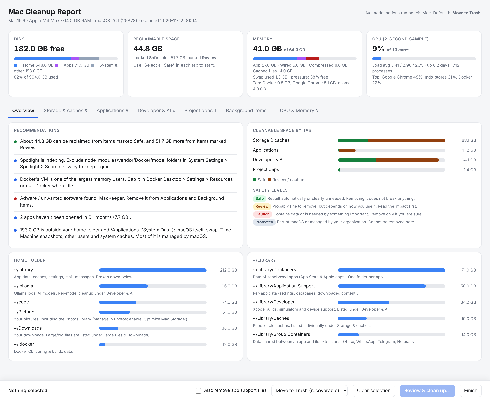
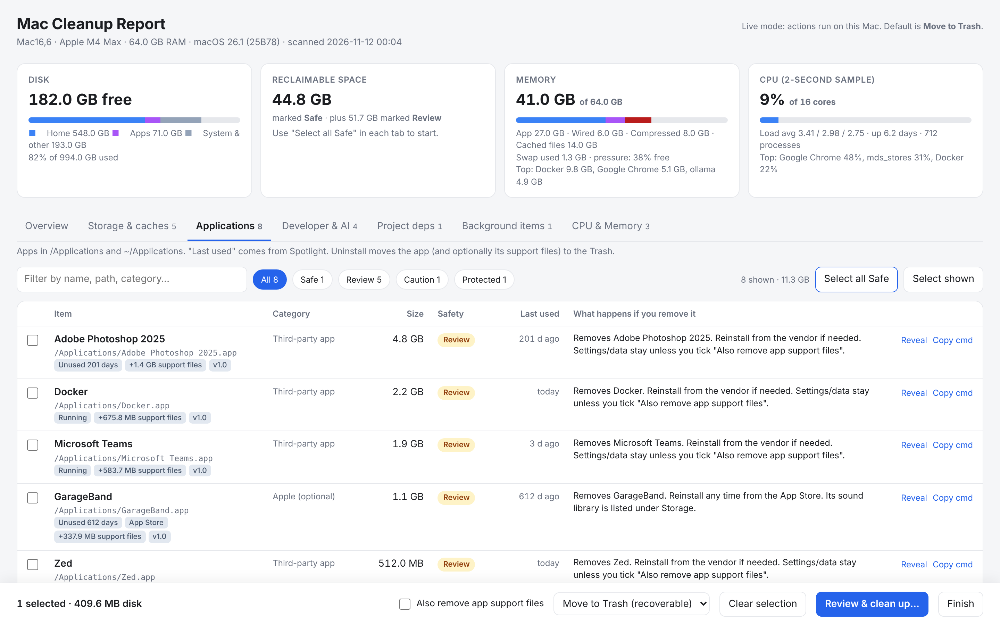

# Mac Cleanup

Find what is using your Mac's **disk, memory and CPU**, see what each item is (macOS system, needed, optional or bloat), and clean it up from an interactive report in your browser.

It is a single Python file with no dependencies. The scan is read-only, and by default everything you remove goes to the Trash.



<sub>Screenshots use sample data.</sub>

---

## Features

- **Disk overview:** a one-pass size map of your home folder, `~/Library`, Application Support and Containers, plus how much space is "System Data".
- **Safety rating for every item:** **Safe** / **Review** / **Caution** / **Protected**, with a plain-language note on *what happens if you remove it*.
- **Storage & caches:** app caches, sandboxed app caches, Electron/Chromium caches (Slack, Teams, VS Code…), logs, Mail downloads, iPhone/iPad backups, old macOS installers, GarageBand/Logic libraries and Time Machine local snapshots.
- **Applications:** size, last-used date (from Spotlight), running state, App Store flag and support-file size. Flags adware/PUPs, unneeded antivirus, optional Apple apps and **IT-managed security/VPN/MDM software** (marked Caution/Protected so you don't break corporate access).
- **Developer & AI:** Xcode DerivedData/DeviceSupport/simulators, Homebrew cleanup, Docker prune, and npm/Composer/pip/Gradle/Bun caches. **Ollama, Hugging Face and LM Studio models** are listed one by one.
- **Project dependencies:** `node_modules`, Composer `vendor`, Python venvs, `.next`, Rust `target` and CocoaPods. Projects untouched for 60+ days are marked Safe.
- **Large files & Downloads:** grouped by type (installers, videos, VM disks, model weights, DB dumps…).
- **Leftovers:** data in `~/Library` from apps that are no longer installed.
- **Background items:** launch agents, launch daemons, login items and `brew services`. Broken agents that point to deleted programs are detected.
- **CPU & Memory:** processes grouped per app (all Chrome helpers together), a live 2-second CPU sample, memory pressure and swap, explanations for common heavy hitters (`kernel_task`, `WindowServer`, Spotlight, Docker VM, Ollama…), and Quit/unload actions.
- **Recommendations:** reclaimable totals, memory pressure, CPU hogs, Spotlight indexing, adware, unused apps and uptime.



---

## Requirements

- macOS 12 Monterey or newer (Apple silicon or Intel)
- Python 3.9+. The `python3` from Xcode Command Line Tools works (`xcode-select --install`).
- No third-party packages.

**Recommended:** give your terminal app **Full Disk Access** (System Settings → Privacy & Security → Full Disk Access → Terminal / iTerm / your editor). Without it, Mail, Messages, Safari, the Trash and some app containers can't be measured, and the report will show a warning.

## Usage

```bash
git clone <your-repo-url> mac-cleanup
cd mac-cleanup
python3 mac_cleanup.py
```

The scan takes about 1–4 minutes. When it finishes, the report opens in your browser. Keep the terminal open while you use it, then click **Finish** (or press `Ctrl+C`) when you're done.

| Option | Description |
|---|---|
| `--quick` | Skip the slower scans (project dependencies, large-file search) |
| `--no-serve` | Static HTML report only. No actions run; you can export the selected items as a reviewable shell script instead |
| `--min-mb N` | Hide items smaller than *N* MB (default `25`) |
| `--large-mb N` | Threshold for "large files" (default `500`) |
| `--port N` | Fixed port for the local report server (default: random) |
| `--no-browser` | Don't open the browser automatically; the URL is printed instead |
| `--no-login-items` | Skip reading Login Items (avoids the one-time "System Events" automation prompt) |

### Cleaning up

1. Browse the tabs. Use **Select all Safe**, the safety filter chips, or tick items yourself.
2. Choose **Move to Trash** (default) or **Delete permanently**. For apps, optionally tick **Also remove app support files**.
3. Click **Review & clean up…**. The confirmation lists every item with its impact and warnings.
4. Click **Preview (dry run)** to see exactly what would happen, then **Clean up**.
5. Empty the Trash to actually free the space.

Every row also has **Copy cmd**, which copies the equivalent shell command if you'd rather do it yourself.

---

## Safety model

| Guard | What it does |
|---|---|
| Read-only scan | Nothing changes until you confirm in the report |
| Trash by default | Removed items go into **one dated folder in the Trash** (`Mac Cleanup YYYY-MM-DD …`) with a `RESTORE.txt` mapping each item to its original location |
| Server-side allow-list | The browser sends only item IDs. The server acts only on paths and commands that the scan itself discovered |
| Protected paths | `/System`, `/usr`, `/bin`, `/sbin`, SIP-protected apps, `~/Library` itself, iCloud Drive, cloud-storage folders, Keychains, Photos/Music libraries and other users' folders are always refused |
| Local only | The report server binds to `127.0.0.1`, checks `Host`/`Origin`, and requires a random per-run token |
| Admin rights | Root-owned items use the standard macOS password dialog, once per batch. Never run the script with `sudo`; it refuses to start as root |
| Running apps | Apps are asked to quit gracefully before they're removed. Process PIDs are re-verified before any signal is sent |
| Audit log | Every action is appended to `~/mac_cleanup_reports/actions.log` |

> **Note:** "Safe" means the item is rebuilt automatically or is clearly unneeded. **Review** and **Caution** items depend on how you use your Mac, so read the impact text before removing them. App support files can contain the app's own data (notes, libraries, chat history).

## Permissions you may see

- **"Terminal wants to control System Events"**: used to read and remove Login Items. Use `--no-login-items` to skip it.
- **"Terminal wants to control Finder"**: used as a fallback to move items to the Trash when the Trash isn't directly writable (no Full Disk Access).
- **"Terminal would like to access data from other apps"**: macOS asks this when touching another app's container.
- **Administrator password**: for system-wide caches, `/Library/LaunchDaemons`, root-owned apps, `purge` and deleting Time Machine snapshots.

## Output files

```
~/mac_cleanup_reports/
├── report-YYYYMMDD-HHMM.html   # static copy of each scan (open any time)
└── actions.log                 # JSON-lines log of everything that was changed
```

## How it works

Built entirely on standard macOS tools and the Python standard library:

| Data | Source |
|---|---|
| Folder sizes | one `du -d 3` pass over your home folder, plus `du` for everything else |
| App metadata / last used | `Info.plist`, `mdls kMDItemLastUsedDate`, `_MASReceipt` |
| Large files | Spotlight (`mdfind`), falling back to `find` |
| Memory | `vm_stat`, `sysctl vm.swapusage`, `memory_pressure` |
| CPU | two `ps` samples 2 seconds apart (CPU-time delta) |
| Background items | LaunchAgents/LaunchDaemons plists, `launchctl list`, System Events login items, `brew services` |
| Tools | `brew`, `docker`, `ollama`, `xcrun simctl`, `tmutil` (each used only if installed) |

## Limitations

- Sizes are allocated disk space. APFS clones and hard links can make totals look larger than the space you'll actually reclaim.
- Memory per app is RSS, which includes shared memory, so it can exceed Activity Monitor's "Memory" column.
- Leftover detection is heuristic (matched by bundle-ID vendor). It is always marked **Review**.
- Data on the sealed macOS system volume isn't shown, because it can't be changed.

## Disclaimer

Use at your own risk. Keep a current backup (Time Machine or similar) before deleting things permanently, and check with your IT department before removing anything on a managed work Mac.
